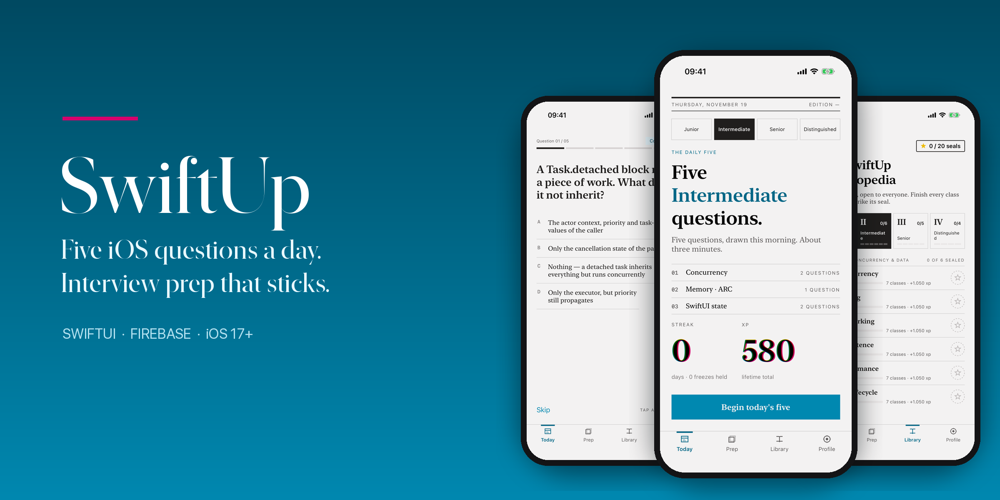
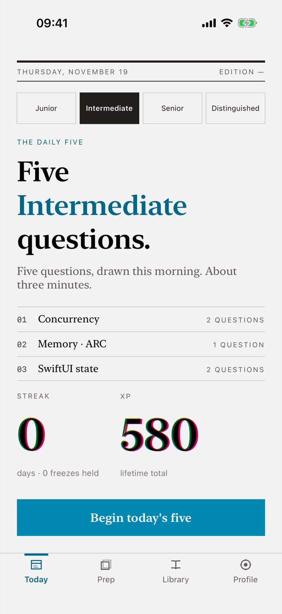
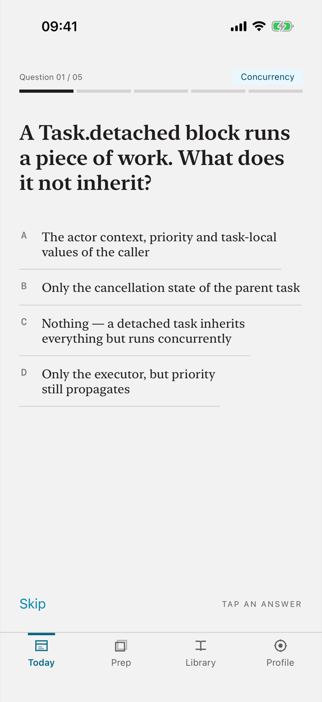
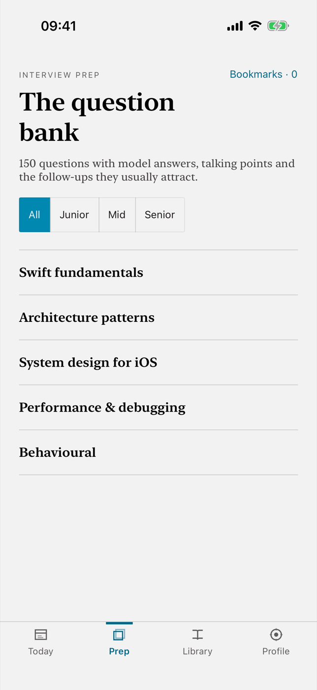
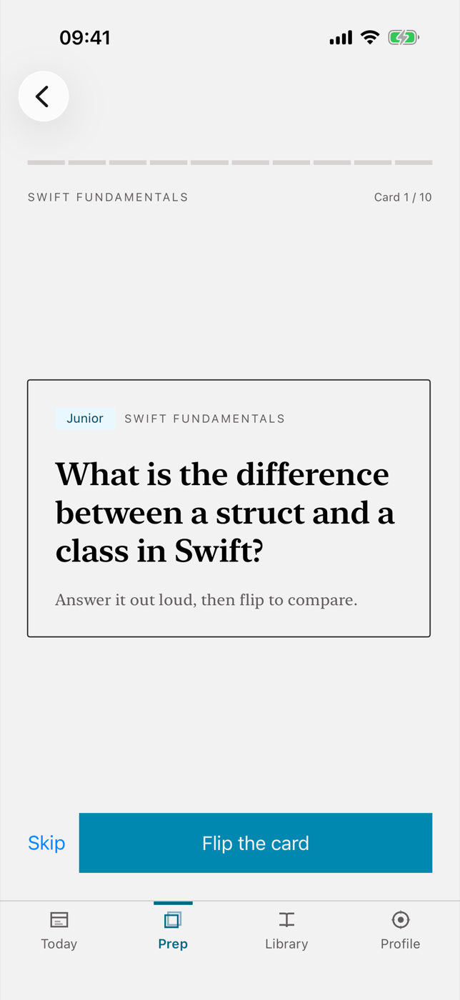
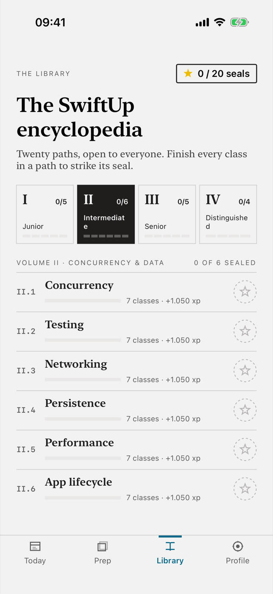
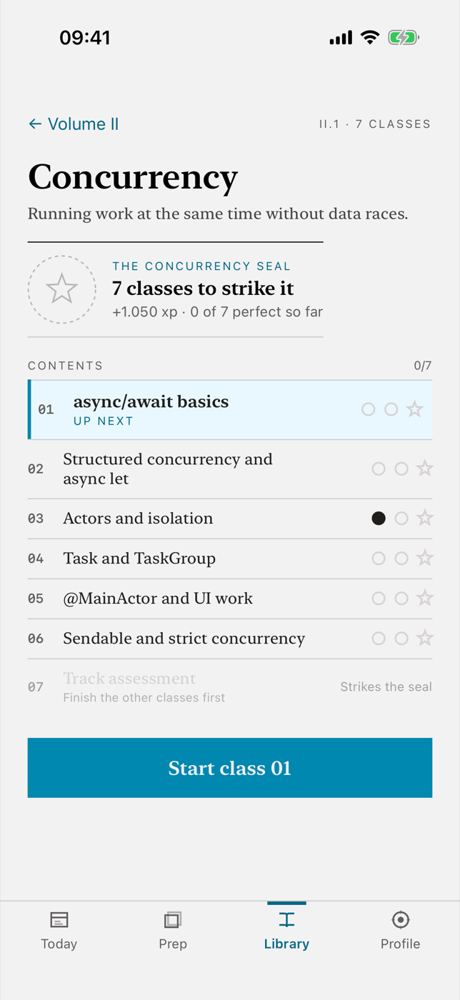

<p align="center">
  
</p>

<h1 align="center">SwiftUp</h1>

<p align="center">
  <b>A daily habit for iOS engineers.</b><br>
  Five questions every morning, a 150-question interview bank you drill as flashcards,<br>
  and a 141-class library that takes you from Junior to Distinguished.
</p>

<p align="center">
  
  
  
  
  
</p>

---

## Why SwiftUp

Interview prep usually happens in a panic, two weeks before the interview. SwiftUp turns it
into something small you do every day: three minutes over coffee, a streak worth protecting,
and a level that tells you honestly where you stand.

It's built to read like a morning paper rather than a game: serif headlines, a dated
**edition** on the masthead, and ruled lists. It still keeps the habit loops that bring
people back: streaks, XP, seals and milestones.

## Screenshots

<table>
  <tr>
    <td align="center"><br><sub><b>The Daily Five</b><br>Today's edition, picked for your grade</sub></td>
    <td align="center"><br><sub><b>Quiz</b><br>Real-world questions with explanations</sub></td>
    <td align="center"><br><sub><b>The question bank</b><br>150 questions across 5 categories</sub></td>
  </tr>
  <tr>
    <td align="center"><br><sub><b>Flashcards</b><br>Answer out loud, flip, rate yourself</sub></td>
    <td align="center"><br><sub><b>The Library</b><br>20 paths in four volumes</sub></td>
    <td align="center"><br><sub><b>A path</b><br>Seven classes to earn its seal</sub></td>
  </tr>
</table>

## Features

### 📰 The Daily Five
- A fresh **edition every day**: five questions picked for your grade (Junior, Intermediate,
  Senior or Distinguished). Everyone at the same grade gets the same set on the same day.
- Multiple-choice and code-reading questions on Swift, SwiftUI, concurrency, memory and
  ARC, architecture, networking, persistence, testing and tooling, with an explanation
  after every answer.
- **Past editions**: go back and redo earlier days, or practise another grade's set.

### 🗂️ Interview Prep
- **150 curated interview questions** in five categories: Swift fundamentals, architecture
  patterns, system design for iOS, performance and debugging, and behavioural. Each one is
  filtered by level.
- Every question comes with a **model answer, talking points and likely follow-ups**.
- **Flashcard sessions**: answer out loud, flip the card, then rate yourself *missed*,
  *shaky* or *nailed*. Your rating decides when the card comes back for review.
- Bookmark the questions you want to keep close.

### 📚 The Library
- **20 learning paths, 141 classes**, arranged in four volumes from *Swift fundamentals* to
  *Engineering culture*.
- Classes read like short articles, and each ends in a quiz. Finish every class in a path,
  then pass its assessment to **strike the path's seal**.
- **Regrade quizzes** let you prove you've outgrown your grade and move up.

### 🔥 Progress that keeps you coming back
- **Streaks with freezes**: a freeze forgives one missed day, and you earn a new one every
  seven days in a row.
- XP, **23 achievement seals**, milestones, and an accuracy-by-topic breakdown that points
  at your weakest areas.
- **Smart local reminders**: a daily quiz nudge, a streak-at-risk alert and a weekly
  edition. All are switchable and respect quiet hours.

### 🔐 Accounts
- Sign in with **Apple**, **Google** or email. Your progress syncs across devices through
  Firestore.

## Tech stack

| Layer | Choice |
|---|---|
| UI | SwiftUI (iOS 17+), Observation (`@Observable`), custom design system |
| Backend | Firebase Authentication · Cloud Firestore, with security rules in [`firestore.rules`](firestore.rules) |
| Sign-in | Sign in with Apple · Google Sign-In · email and password |
| Ads | Google Mobile Ads, rewarded ads to unlock past editions |
| Notifications | `UserNotifications`, planned by a pure, unit-tested scheduler |
| Project | [XcodeGen](https://github.com/yonaskolb/XcodeGen) (`project.yml`), Swift Package Manager |
| Tests | Swift Testing: 119 tests across 11 suites |
| Content tooling | Python scripts that seed Firestore (`scripts/`) |

The app targets iPhone in portrait, with a fixed light palette defined in `DesignSystem/Theme.swift`.

## Architecture

```
SwiftUp/
├── App/            Entry point, root routing (splash → auth → onboarding → tabs), tab shell
├── Features/       One folder per screen family
│   ├── DailyQuiz/      Today, editions, quiz session, summary, rewarded-ad gate
│   ├── InterviewPrep/  Question bank, detail, flashcard sessions
│   ├── Library/        Paths, class articles, quizzes, regrades
│   ├── Profile/        Stats, badges, milestones, accuracy by topic
│   └── Auth · Onboarding · Settings · Support
├── Data/           Repositories (Firestore + bundled fallbacks) and pure logic
│                   (StreakCalculator, AchievementEngine, ReminderScheduler, …)
├── Models/         Codable models
├── DesignSystem/   Theme tokens, typography, reusable atoms, custom tab bar
└── Resources/      Bundled JSON content, used offline and as a first-launch fallback
```

- **Repositories as `@Observable` environment objects.** Each feature reads from a repository
  (`QuestionRepository`, `LibraryRepository`, …). Repositories load from Firestore; the
  daily quiz and the interview bank fall back to bundled JSON when the network or today's
  document isn't there.
- **The rules live in pure types.** Streaks, achievements, flashcard scheduling and reminder
  planning are plain Swift with an injected clock, so they're unit-tested without a
  simulator or network.
- **The server owns shared content.** Daily editions are Firestore documents keyed by date,
  so every user at a grade sees the same edition, and the client can never disagree with the
  server about what "today" is.

## Getting started

### Requirements
- Xcode 16 or later (developed on Xcode 26), with the iOS 17+ simulator
- [XcodeGen](https://github.com/yonaskolb/XcodeGen): `brew install xcodegen`
- A Firebase project of your own (the free Spark plan is enough)

### 1. Clone and generate the project
```bash
git clone https://github.com/Amine-mdidech/SwiftUp.git
cd SwiftUp
xcodegen generate
```

### 2. Connect your Firebase project
The Firebase config isn't committed. Supply your own:

1. In the [Firebase console](https://console.firebase.google.com), create a project and add
   an **iOS app** with bundle ID `com.swiftup.dailyquiz` (or your own; see below).
2. Enable **Authentication** with Apple, Google and Email/Password, and create a
   **Cloud Firestore** database.
3. Download `GoogleService-Info.plist` into `SwiftUp/`. Use
   [`GoogleService-Info.example.plist`](GoogleService-Info.example.plist) as a reference
   for the expected shape.
4. In `project.yml`, replace the Google Sign-In URL scheme
   (`com.googleusercontent.apps.…`) with the `REVERSED_CLIENT_ID` from your plist, and set
   `DEVELOPMENT_TEAM` to your own Apple team ID.
5. Deploy the security rules: `firebase deploy --only firestore:rules`

> Using your own bundle ID? Change `PRODUCT_BUNDLE_IDENTIFIER` in `project.yml` and register
> that ID in Firebase instead.

### 3. Seed the content
The daily quiz and the interview bank fall back to bundled questions, but the daily
editions and the Library are served from Firestore, so seed them once. The scripts need a
service-account key, which is git-ignored; never commit it. See
[`scripts/README.md`](scripts/README.md).

```bash
pip install firebase-admin
python3 scripts/seed_questions.py
python3 scripts/seed_daily_quizzes.py     # the next 14 days of editions
python3 scripts/seed_interview_bank.py
python3 scripts/seed_path_tracks.py && python3 scripts/seed_path_content.py
```

### 4. Run
Open `SwiftUp.xcodeproj`, pick an iOS 17+ simulator and press **⌘R**.

### Tests
```bash
xcodebuild test -project SwiftUp.xcodeproj -scheme SwiftUp \
  -destination 'platform=iOS Simulator,name=iPhone 17'
```

## Roadmap
- [ ] Live coding sessions: an in-app Swift editor with timed challenges
- [ ] Adaptive difficulty based on your answer history
- [ ] Dark mode
- [ ] Widgets for today's edition and your current streak

---

<p align="center">
  Built by <a href="https://github.com/Amine-mdidech">@Amine-mdidech</a> with SwiftUI and a lot of coffee ☕
</p>
